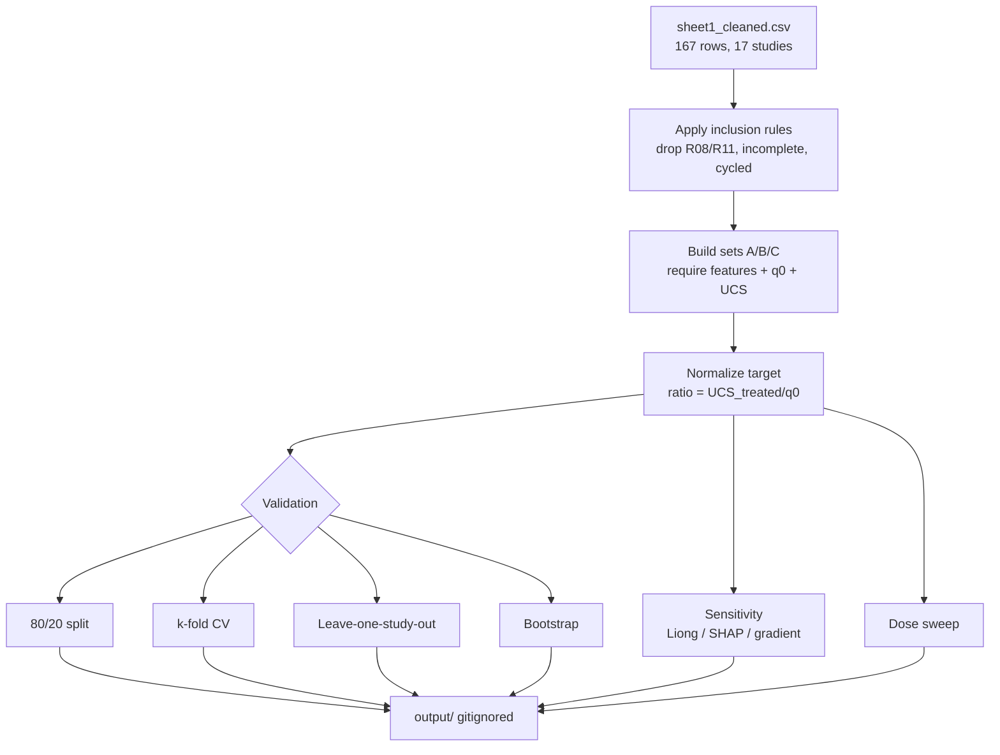

# Chitosan-stabilized expansive clay — a curated dataset and white-box GMDH modelling framework

*Technical report · graduation project · status: data complete, model calibration in progress*

---

## 1. Introduction

Expansive soils — clays dominated by montmorillonite or mixed-layer minerals —
swell on wetting and shrink on drying. This volume instability damages
lightly-loaded infrastructure (pavements, shallow footings, canal linings and
utility trenches) and is a recurring problem in arid and semi-arid regions.
Traditional stabilization relies on lime and Portland cement, both of which are
energy- and CO₂-intensive to produce. Biopolymers offer a lower-carbon
alternative, and among them **chitosan** is attractive because it is
biodegradable, widely available from crustacean-shell waste, and chemically
functionalizable.

Chitosan is the deacetylated derivative of chitin, a linear polysaccharide of
β-(1→4)-linked D-glucosamine and N-acetyl-D-glucosamine units. Its
geotechnical interest comes from the **free primary amino (–NH₂) groups** along
the chain: in mildly acidic solution these become protonated (–NH₃⁺), giving
chitosan a **polycationic** character that associates with the negatively
charged surfaces of clay particles. The degree of deacetylation (DDA) and
molecular weight control how many cationic sites are available and how strongly
chains bridge particles, so they are expected to govern strength development —
yet many published soil-stabilization studies do not report them.

Two gaps motivate this work. First, chitosan-soil datasets are small and
fragmented: results are scattered across journals, use different soils, doses
and curing regimes, and frequently report strength only as a percentage gain
rather than an absolute value. Second, although white-box machine-learning
models have been published for xanthan-gum-stabilized soils (the methodological
template of this project), no equivalent unified, interpretable model exists for
chitosan. The objectives of this project are therefore:

1. to build a **curated, provenance-tagged dataset** of laboratory
   geotechnical results for chitosan-treated cohesive and expansive soils;
2. to document a **reproducible extraction protocol** (search, screening,
   digitization, QA);
3. to implement a **white-box GMDH modelling framework** with rigorous
   validation and sensitivity analysis, mirroring the xanthan-gum study; and
4. to design a **laboratory programme** in which a raw chitosan is compared with
   three chemically modified forms — quaternized with
   glycidyltrimethylammonium chloride (GTMAC), converted to a Schiff base, and
   processed as an ionic liquid — in order to test whether permanent cationic
   charge and higher DDA improve stabilization of an expansive clay.

The modelling component is reported here as a *protocol and framework*;
calibration against the dataset is ongoing (Section 5).

## 2. Search and extraction protocol

### 2.1 Search strategy

Candidate studies were located through iterative searches of bibliographic
indexes and publisher sites using combinations of the terms *chitosan,
biopolymer, soil stabilization, expansive clay, unconfined compressive
strength, Atterberg limits, consolidation, swell*. Records were obtained via
OpenAlex and direct publisher/DOI retrieval. Full texts were read directly from
open-access PDFs wherever possible.

### 2.2 Inclusion and exclusion criteria

A study was **included** in the primary dataset (`sheet1_cleaned.csv`) when it
reported a laboratory test of a **chitosan-treated cohesive, expansive or
organic-silt soil** with at least one numeric geotechnical result (UCS, Atterberg
limits, CBR, swell or consolidation). Studies were **excluded** when:

- the stabilizer was not chitosan, or chitosan was only a minor co-additive in a
  composite whose primary agent was another material;
- the soil was dominantly sand (chitosan–sand studies sit outside the expansive-
  clay scope);
- only the *untreated* soil was characterised;
- the full text was paywalled and could not be retrieved without circumventing
  the access control (Section 2.4).

A separate sheet (`sheet3_modified_chitosan.csv`) records chemically modified
chitosan systems (quaternized, polyelectrolyte-complex, grafted) that inform the
planned laboratory work but are **out of scope** for the UCS model.

### 2.3 PRISMA-style flow (real counts)

The screening was iterative rather than a single database pull, so the
top-of-funnel retrieval count was not logged; the counts below are the records
that reached full-text eligibility assessment.

| Stage | Count |
|---|---|
| Excluded — duplicate of an already-included study | 2 (Wang 2025 *Polymers* = R01; Firmansyah 2024 *SEAGS* = R10) |
| Excluded — out of scope (sand / sand–kaolin / collapsible soil) | 2 (Salimi 2025 *GEOMATE*; Fatehi 2026 *Polymers*) |
| Excluded — full text inaccessible (paywall / 403 / captcha) | 8 DOIs (Section 2.4) |
| **Included — primary dataset (`sheet1`)** | **17 studies (R01–R17)** |
| **Included — modified-chitosan sheet (`sheet3`)** | **5 studies (M01–M05)** |

### 2.4 Paywalled and inaccessible full texts

Full texts behind ScienceDirect's Cloudflare challenge, an HTTP 403, or a
timeout were **not** bypassed with mirrors or proxies; they are recorded as
inaccessible and their values are left out of the dataset rather than inferred.
Inaccessible records include: `10.1016/j.jrmge.2025.10.016`,
`10.1016/j.carbpol.2022.120227`, `10.1016/j.sandf.2026.101730`,
`10.1016/j.clet.2026.101237`, `10.1016/j.cscm.2025.e04528`,
`10.1016/j.trgeo.2023.101110` (ScienceDirect captcha);
`10.30880/ijie.2026.18.03.017` (timeout); and
`10.1051/e3sconf/202461703022` (HTTP 403). One conference proceeding
(R09, Reddy 2018) is available only as a ResearchGate record without an open
full text.

### 2.5 Duplicate handling

Before entry, each candidate was checked against the existing `Ref_ID`s by
title, DOI and authorship. Two 2024–2025 records duplicated studies already in
the dataset and were dropped (Section 2.3). Within the dataset, an automated
check confirms there are **no exact duplicate rows** (`scripts/dataset_checks.py`).

### 2.6 Figure digitization and QA

Absolute UCS values that appear only as bar charts were digitized from the
figure axes. Where a figure was low-resolution or hatched such that bar values
could not be read reliably, the values were **not** recorded (the "never invent"
rule); instead the study was retained with the percentage gains the text
reports. For R16, a pre-digitized set of 27 UCS values read from Figures 6a, 6b
and 7 was supplied and cross-checked against the paper's stated percentage
gains to within 1 point (e.g. Ganga silt 1 % dose: 290/243 = +19.3 % vs. the
stated +19 %). Every digitized value is tagged `graph-estimated`.

### 2.7 Derived-value rules

A value is labelled `derived` when it is computed from other recorded values
rather than read directly. The arithmetic is written out in `Value_Source` so it
can be re-checked; the only derivation used for UCS is
`UCS_treated = q0 × (1 + ΔUCS/100)` where `ΔUCS` is a percentage improvement
read from a figure or text. Ranges (e.g. "24–25") are left non-numeric and are
not averaged.

### 2.8 Inconsistency log

- **R03 (Parmar 2020):** printed PL (62.5) yields a negative PI from the stated
  LL; the PI is treated as missing.
- **R10 (Firmansyah SEAGS):** curing time not reported.
- **R13 (Sujatha 2024):** compaction moisture recorded as "at OMC" per dose, so
  there is no single numeric WMC; 20 of 40 rows use a chitosan + 3 %
  calcium-metasilicate (calsil) co-additive.
- **R16 (Jha & Roy 2026):** absolute UCS is graph-only; DDA and molecular weight
  are not stated.
- **R09 (Reddy 2018):** access status differs between the study summary ("full
  text read") and the paywalled list ("no open full text"); to be reconciled.

## 3. Database

### 3.1 Scope

The primary dataset holds **167 rows across 17 studies (R01–R17)** with a
48-column schema (see the data dictionary in `data/data_dictionary.md`). The
model-ready view `data/data_used.csv` holds the **139 rows across 7 studies**
that have a plasticity index, chitosan dose, curing time, untreated UCS and
treated UCS.

### 3.2 Per-study summary

| Ref | Study (short) | Year | Soil | Rows | Primary treated outputs |
|---|---|---|---|---|---|
| R01 | Wang et al. | 2025 | Kaolinite silt | 8 | UCS |
| R02 | Bukhary & Azam | 2024 | Regina clay | 3 | swell %, swell–consolidation |
| R03 | Parmar et al. | 2020 | Bhavnagar black cotton | 3 | UCS, swell pressure |
| R04 | Kannan et al. | 2024 | Ariyalur organic silt | 2 | PI |
| R05 | Kannan et al. | 2026 | Ariyalur organic silt | 31 | LL, PI, UCS, secant modulus |
| R06 | Jamshidi et al. | 2025 | Marl | 4 | UCS |
| R07 | Banne et al. | 2025 | Laterite | 3 | CBR (soaked/unsoaked) |
| R08 | Kannan & Sujatha | 2023 | Ariyalur organic silt | 4 | UCS (secondary) |
| R09 | Reddy et al. | 2018 | Expansive soil | 20 | CBR, LL, PI, UCS |
| R10 | Firmansyah et al. | 2024 | Soft clay | 1 | UCS |
| R11 | Rasheed et al. | 2023 | Kuttanad soft soil | 2 | UCS |
| R12 | Rasheed et al. | 2023 | Kuttanad soft soil | 4 | LL |
| R13 | Sujatha et al. | 2024 | Low-compressible clay | 40 | UCS |
| R14 | Firmansyah et al. | 2024 | Expansive soil | 4 | LL, PL, PI |
| R15 | Azimi et al. | 2024 | Kaolin–bentonite (75:25) | 10 | UCS |
| R16 | Jha & Roy | 2026 | Ganga silt; black cotton; bentonite | 27 | LL, PL, PI, UCS (graph) |
| R17 | Kannan et al. | 2024 | Ariyalur organic silt (nano) | 1 | UCS |

### 3.3 Descriptive statistics (all rows with a value)

| Variable | n | min | mean | max | SD |
|---|---|---|---|---|---|
| Plasticity index (–) | 160 | 2.81 | 26.1 | 63.4 | 13.9 |
| Chitosan dose (%) | 167 | 0.02 | 1.00 | 4.0 | 0.80 |
| Curing time (d) | 161 | 0 | 27.2 | 180 | 38.3 |
| Initial moisture (%) | 120 | 10 | 22.2 | 45.4 | 7.4 |
| Untreated UCS q0 (kPa) | 153 | 113 | 198 | 407 | 78 |
| Treated UCS (kPa) | 148 | 129 | 427 | 4300 | 478 |

For the normalized target on the seven model studies,
`UCS_treated / q0` ranges from **0.855 to 21.6** (mean 2.22, SD 2.66).

### 3.4 Missing-data matrix

The most complete columns are the treatment descriptors (dose 167/167) and
untreated limits (LL/PL 163/167). The largest gaps are the treated-volume-change
outputs — free swell index after treatment (0 rows), swell percent and swell
pressure after treatment (1 row each) — and curing temperature, which is numeric
in only 45 rows (most papers report "ambient" only). The full matrix is rendered
as a coverage heatmap in `figures/fig10_coverage_heatmap.png`.

### 3.5 Provenance

By normalized label, the 167 rows break down as **table 101, text 30,
graph-estimated 28, derived 8** (Section 1 of the data dictionary).

## 4. Data figures

All figures are generated from the data by `scripts/make_figures.py` (300 dpi,
white background, labelled axes with units, one categorical palette). Each is
referenced here.

1. `fig01_rows_per_study.png` — row count per study (R01–R17).
2. `fig02_histograms.png` — distributions of PI, dose, curing time, moisture,
   q0 and treated UCS with normal-density overlays.
3. `fig03_correlation_heatmap.png` — Pearson correlation among the six core
   variables on the complete rows.
4. `fig04_vif.png` — variance inflation factor for the four predictors; the
   dashed line marks the conventional threshold of 5.
5. `fig05_pairplot.png` — pairwise input space (PI, dose, curing, moisture),
   coloured by study.
6. `fig06_ucs_vs_dose.png` — treated UCS against chitosan dose per study, lines
   coloured by curing time.
7. `fig07_ucs_vs_curing.png` — treated UCS against curing time per study, lines
   coloured by dose.
8. `fig08_ratio_dose_pi.png` — normalized strength `UCS/q0` against dose and
   against PI.
9. `fig09_boxplots_form_curing.png` — `UCS/q0` boxplots grouped by chitosan
   form/solvent and by curing regime.
10. `fig10_coverage_heatmap.png` — study × property non-missing fraction.
11. `fig11_input_space_by_study.png` — PI vs dose coverage coloured by study.

The dose and curing curves show that the response is **form-dependent and
non-monotonic**: some chitosan forms gain strength monotonically over the tested
dose range while others peak and then decline, and the effective dose scale
differs by an order of magnitude between studies. This heterogeneity is exactly
the between-study spread that Section 5's validation protocol is designed to
stress.

## 5. Modeling framework

### 5.1 Model form

The white-box model is the **Group Method of Data Handling (GMDH)**. It
approximates the response `y` by a **Kolmogorov–Gabor** functional series over
the inputs `x₁…x_d`:

    y = a₀ + Σᵢ aᵢxᵢ + Σᵢ Σⱼ aᵢⱼxᵢxⱼ + Σᵢ Σⱼ Σₖ aᵢⱼₖxᵢxⱼxₖ + …

In practice each *neuron* is a **partial quadratic polynomial** over a pair of
the previous layer's outputs `(vᵢ, vⱼ)`:

    u = a₀ + a₁vᵢ + a₂vⱼ + a₃vᵢvⱼ + a₄vᵢ² + a₅vⱼ²

Neurons are stacked in layers; each layer combines pairs of the previous layer's
neurons, and only neurons that improve a held-out selection split are retained
(the self-organizing step). The output is the **average** of the final layer's
selected neurons. Because every neuron is an explicit polynomial, the whole
network can be expanded symbolically into a single readable equation — this is
what makes the model "white-box".

### 5.2 Regularization and hyper-parameters

- **Selection threshold** `α = 0.6`: a neuron is kept when its validation MSE is
  within `(1 + α)` of the best validation MSE in its layer.
- **Ridge** (`λ = 10`) on the normal equations for numerical stability against
  near-collinear pairs.
- **Standardization** of inputs and target before fitting.
- **Architecture**: `max_layers = 1` (single hidden layer), capped at 8 neurons,
  with a 30 % internal selection split — the only stable choice on a dataset of
  this size.

### 5.3 Input sets and targets

To remove the per-study baseline strength, the target is normalized by the
untreated UCS (`q0`):

| Set | Inputs |
|---|---|
| A | `CC` (dose), `CTi` (curing), `PI` |
| B | A + `WMC` (compaction moisture) |
| C | B + `q0` (untreated UCS as a predictor) |

Targets: `ratio = UCS_treated / q0` and `logratio = ln(UCS_treated / q0)`. Sets
are nested: A is the largest row set; B and C share the same (smaller) rows and
differ only in whether `q0` is a predictor.

### 5.4 Validation protocol

Four protocols are implemented, all with fixed seeds:

1. **Random 80/20 split** (seed 42) — a single deterministic train/test hold-out.
2. **k-fold cross-validation** (k = 5, seed 0) — repeated random folds.
3. **Leave-one-study-out (LOSO)** — the *headline* protocol: train on every
   study but one and predict the held-out study, so that a study can never leak
   into its own training data. This is the correct test of **cross-soil**
   generalization, because PI, moisture and q0 are constant *within* a study and
   only the multi-soil study (R16) carries within-study soil variation.
4. **Bootstrap** (1000 resamples, seed 123) — a distribution of the in-sample
   metric.

Metrics: coefficient of determination
`R² = 1 − Σ(y−ŷ)² / Σ(y−ȳ)²`, root-mean-square error
`RMSE = √(mean((y−ŷ)²))`, and mean absolute error `MAE = mean(|y−ŷ|)`.

> **Model calibration and validation: in progress.** Numeric results are
> produced by `model/model.py` into the gitignored `output/` directory and are
> deliberately not committed to this repository.

### 5.5 Sensitivity and importance

Three complementary methods are implemented to interpret the white-box model:

- **Liong et al. (2000)** — one-at-a-time perturbation of each input by factors
  0.8, 0.9, 0.95 and 0.99, measuring the induced change in output.
- **SHAP** — KernelSHAP values on the GMDH as a callable, giving a global
  feature-importance ranking.
- **Gradient importance** — the mean magnitude of `∂ŷ/∂xᵢ` via central finite
  differences on the expanded polynomial.

### 5.6 Dose-sweep procedure

To map the dose response, the dose (`CC`) is swept over a grid while the other
inputs are held at their medians. The sweep is reported as a *curve*, not a
point optimum: any optimum that sits on the grid boundary is an artefact of the
sweep range, not a physical optimum.

### 5.7 Leakage policy

- Standardization parameters (mean/SD) are always computed **on the training
  split only** and applied to the test split.
- LOSO and k-fold never allow a row's own study into training.
- The internal GMDH selection split is seeded and independent of the outer
  validation split.
- R08 (secondary values copied from R05) and R11 (an approximate single row) are
  excluded from the model so their provenance does not bias training.

### 5.8 Methodology flow diagram



## 6. Physical interpretation (cited hypotheses)

The mechanisms below are hypotheses advanced in the source studies, restated in
our words.

- **Electrostatic adsorption and charge screening.** Protonated chitosan
  (cationic) associates with the negatively charged faces of clay particles,
  neutralising some of the surface charge and promoting flocculation; a higher
  plasticity index (more active clay) is expected to interact more strongly, but
  also to swell more and resist the cross-linking the polymer can provide.
- **Hydrogen bonding and bridging.** Chitosan's hydroxyl and amine groups form
  hydrogen bonds with clay surfaces and water, and long chains can bridge
  adjacent particles, adding cohesion.
- **Moisture sensitivity.** Because chitosan is hydrophilic, compaction moisture
  strongly modulates the result: too little water prevents uniform gel
  formation and too much weakens the matrix, so the dose–moisture interaction is
  expected to matter.
- **Form and solvent dependence.** Whether chitosan is applied as a dry powder,
  dissolved in dilute acid, or as nanoparticles changes how finely it disperses
  and how many cationic sites are exposed, shifting the effective dose scale by
  an order of magnitude and changing whether strength rises monotonically or
  peaks. DDA and molecular weight — often unreported — are the underlying
  controls.

These hypotheses motivate the planned modifications (Section 8): permanent
quaternization (GTMAC) should remove the need for acid protonation, and a Schiff
base / ionic-liquid route should alter solubility and cation availability.

## 7. Limitations

- **Small and heterogeneous sample.** 17 studies span different soils, chitosan
  forms, doses and curing regimes; the between-study spread can exceed the
  within-study dose/curing signal.
- **Confounding.** Within any single study, PI, moisture and q0 are constant, so
  only the multi-soil study (R16) separates soil type from the treatment; many
  other studies carry one soil only.
- **Missing metadata.** DDA and molecular weight are frequently absent, and
  curing temperature is rarely numeric; both are likely important.
- **Sparse swelling data.** Free-swell index and swell pressure after treatment
  are nearly absent (0–1 rows), the largest gap for the project's expansive-soil
  targets.
- **Provenance quality.** 28 rows are graph-estimated and 8 are derived; absolute
  UCS for R16 is read from figures and is not as precise as tabulated values.
- **Access bias.** Several otherwise-eligible studies are paywalled and were
  excluded per the no-circumvention rule, which may skew coverage.
- **No tabulated multi-soil chitosan study beyond R16** with absolute UCS was
  found; further studies are needed before cross-soil prediction can be claimed.

## 8. Planned laboratory programme

A complementary experimental series will compare a **raw** chitosan with three
**modified** forms on a single expansive clay, so that DDA / cation availability
can be isolated from soil type:

- **Raw chitosan** — commercial, as a control.
- **GTMAC-quaternized chitosan** (N-(2-hydroxypropyl)-3-trimethylammonium
  chitosan) — introduces permanent quaternary ammonium groups that are cationic
  across all pH.
- **Schiff-base chitosan** — reaction of the amine with an aldehyde to form an
  imine, optionally reduced, to tune solubility and cross-linking.
- **Ionic-liquid-processed chitosan** — chitosan dissolved or derivatized in an
  ionic-liquid medium to improve dispersion.

Test matrix:

| Factor | Levels |
|---|---|
| Chitosan dose (by dry soil mass) | 0.25, 0.5, 1.0, 2.0 % |
| Curing time | 7, 14, 28 d |
| Specimen compaction | at optimum moisture content, standard effort |

Measurements: Atterberg limits (LL, PL, PI), free swell index, swell pressure,
unconfined compressive strength (UCS), California bearing ratio (CBR, soaked and
unsoaked), and durability under wet–dry cycles. Each combination will record
chitosan DDA and molecular weight so that the two missing covariates can
eventually be added to the model.

## 9. References

Only studies present in the dataset, plus the methodological template, are cited.

1. Wang R., Ong D.E.L., Sadighi H., Goli M., Xia P., Fatehi H., Yao T. (2025). Optimizing Soil Stabilization with Chitosan: Investigating Acid Concentration, Temperature, and Long-Term Strength. *Polymers* 17(2):151. doi:10.3390/polym17020151.
2. Bukhary A., Azam S. (2024). Flow through and Volume Change Behavior of a Compacted Expansive Soil Amended with Natural Biopolymers. *Geotechnics* 4(1):322–336. doi:10.3390/geotechnics4010017.
3. Parmar J., Yadav V., Pandya S. (2020). Influence of Biopolymer Treatment on Suction Characteristics of Bhavnagar Expansive Soil. *Proc. Indian Geotechnical Conference 2020*, pp. 700–716.
4. Kannan G., O'Kelly B.C., Sujatha E.R. (2024). Effect of chitin, chitosan and NaCMC biopolymers on the consistency limits of organic silt. *Int. J. Environ. Sci. Technol.* 21:2121–2128. doi:10.1007/s13762-023-05022-4.
5. Kannan G., Sujatha E.R., O'Kelly B.C. (2026). Investigation on geoengineering properties of organic silt soil treated with chitosan nanoparticle additive. *Scientific Reports* 16:7793. doi:10.1038/s41598-026-39151-w.
6. Jamshidi M., Mokhberi M., Vakili A.H., Nasehi S.A. (2025). Investigating the geotechnical characteristics of improved marls with chitosan biopolymer. *Advances in Applied Geology* 14(4):896–913. doi:10.22055/aag.2024.45810.2429.
7. Banne S.P., Ingle G.S., Dhawale A., Gaikwad S., Bobade S. (2025). Experimental study on the stabilization of laterite soil with chitosan biopolymer for subgrade applications. *Engineering and Applied Science Research* 52(3):270–281. doi:10.14456/easr.2025.24.
8. Kannan G., Sujatha E.R. (2023). Crustacean polysaccharides for the geotechnical enhancement of organic silt. *Carbohydrate Polymers* 299:120227. doi:10.1016/j.carbpol.2022.120227.
9. Reddy D.V.S.S., Kowshik K., Kishor M.J., Chittaranjan M., Sravani E. (2018). Investigation of Chitosan Bio-Polymer Effect on the Geotechnical Properties of an Expansive Soil. *Proc. ICRTEMMS-2018*.
10. Firmansyah D.A., Somantri A.K., Sihombing A.V.R., Sundara A., Mase L.Z. (2024). Mechanical Properties of Soft Clay Soil Improved with Nanomaterials and Chitosan Biopolymer. *Geotechnical Engineering (SEAGS-AGSSEA Journal)*. doi:10.14456/seagj.2024.13.
11. Rasheed R.M., Moghal A.A.B., Rambabu S., Almajed A. (2023). Sustainable assessment and carbon footprint analysis of polysaccharide biopolymer-amended soft soil. *Frontiers in Environmental Science* 11:1214988. doi:10.3389/fenvs.2023.1214988.
12. Rasheed R.M., Moghal A.A.B., Jannepally S.S.R., Rehman A.U., Chittoori B.C.S. (2023). Shrinkage and Consolidation Characteristics of Chitosan-Amended Soft Soil. *Buildings* 13(9):2230. doi:10.3390/buildings13092230.
13. Sujatha E.R., Balasubramanian N., Gowrisankar E., Muthukrishnan S., Vishweshwaran M. (2024). Mechanical Behaviour of Soil Treated with Chitosan and Calcium Metasilicate. *Sustainability* 16(15):6408. doi:10.3390/su16156408.
14. Firmansyah D.A., Somantri A.K., Sihombing A.V.R., Sundara A., Mase L.Z. (2024). Optimization of the Atterberg Limits on expansive soil stabilized with chitosan biopolymer. *E3S Web of Conferences* 479:06002. doi:10.1051/e3sconf/202447906002.
15. Azimi M., Soltani A., Mirzababaei M., Jaksa M.B., Ashwath N. (2024). Biopolymer stabilization of clayey soil. *Journal of Rock Mechanics and Geotechnical Engineering*. doi:10.1016/j.jrmge.2023.12.020.
16. Jha A.K., Roy L.B. (2026). Geotechnical performance of chitosan-amended soil. *Materials Research Express* 13:195302. doi:10.1088/2053-1591/aea810.
17. Kannan G., Sujatha E.R., Arrieta Baldovino J.J., Nunez de la Rosa Y.E. (2024). Foundation Model Study on Inorganic and Biopolymer Nano Additives Treated Soil. *Sustainability* 16(21):9562. doi:10.3390/su16219562.
18. Taslimi Paein-Afrakoti M., Ghazavi M. (2026). Unified model for prediction of the strength of soils stabilized with xanthan gum using white-box machine learning. *Scientific Reports* 16:22136. doi:10.1038/s41598-026-51877-1. *(methodological template)*

## 10. Appendices

### A. Column dictionary

See `data/data_dictionary.md` for the 48-column schema, units and the four
provenance labels.

### B. Per-study notes

Per-study extraction caveats and derivation formulae live in the `Notes` and
`Value_Source` columns of `sheet1_cleaned.csv`, and are summarized in
`data/study_summary.csv`.

### C. Inconsistency log

Section 2.8 lists the known source inconsistencies and how each was resolved
(usually by treating the affected value as missing).

### D. Reproduction commands

```bash
pip install -r requirements.txt
python scripts/dataset_checks.py   # integrity checks (exit 0 = pass)
python scripts/make_figures.py     # regenerate figures/
python model/model.py              # run the pipeline -> output/
```

All random steps use the fixed seeds in `model/config.py`; the data files are
read-only to the pipeline.
